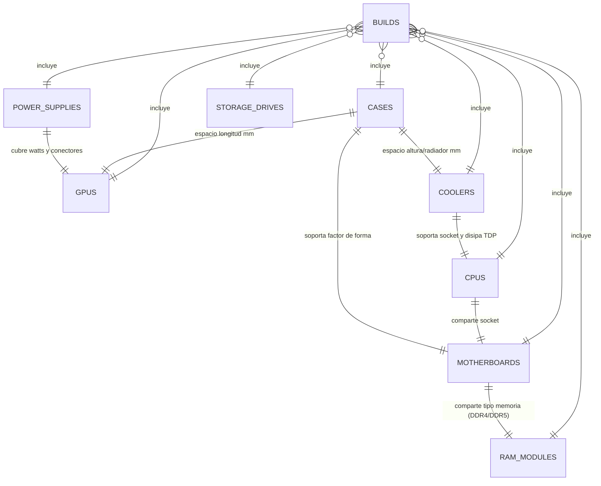
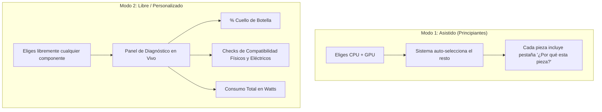

# 🗄️ Diseño de Base de Datos y Motor de Compatibilidad / Cuello de Botella

Este documento detalla la estructura relacional de la base de datos, las fórmulas matemáticas para el cálculo de compatibilidad y cuello de botella (*bottleneck*), y la arquitectura para soportar tanto el **Modo Asistido** (recomendación automática) como el **Modo Libre** (selección manual total con diagnóstico en tiempo real).

---

## 🏛️ 1. Diagrama Entidad - Relación (ERD)

---

## 📊 2. Tablas y Campos Clave

El script SQL completo ha sido generado en [`database/schema.sql`](file:///d:/Proyectos/building-pc/database/schema.sql).

### Resumen de Entidades Principales:
1. **`cpus`**: Socket, núcleos, hilos, TDP base, TDP pico (`max_power_watts`), tipo de memoria (`DDR4`, `DDR5`), puntajes de rendimiento mono/multinúcleo (`cpu_score_single`, `cpu_score_multi`) y gama (`tier`).
2. **`gpus`**: VRAM, dimensiones físicas (`length_mm`, `slot_width`), TDP (`tdp_watts`), fuente recomendada, conectores de alimentación, y puntuaciones de rendimiento por resolución (`gpu_score_1080p`, `gpu_score_1440p`, `gpu_score_4k`).
3. **`motherboards`**: Socket, factor de forma (`ATX`, `mATX`, `ITX`), tipo de memoria, slots M.2 y nivel de calidad de VRMs (`vrm_quality_tier`).
4. **`coolers`**: Tipo (aire o líquida AIO), dimensiones (`height_mm`, `radiator_size_mm`), capacidad térmica (`max_tdp_cooling_capacity`) y sockets soportados.
5. **`power_supplies` (PSU)**: Potencia total (`wattage`), eficiencia (`80+ Bronze/Gold`), conectores disponibles y estándar PCIe 5.0 (`12VHPWR`).
6. **`cases` (Gabinetes)**: Factores de placa soportados, holgura máxima de GPU (`max_gpu_length_mm`), altura máxima de disipador (`max_cooler_height_mm`) y soporte de radiadores.
7. **`ram_modules`**: Generación (`DDR4`/`DDR5`), capacidad, frecuencia y latencia.
8. **`storage_drives`**: Formato (`M.2 NVMe`, `SATA`), capacidad y velocidades.
9. **`builds`**: Ensambles completos con métricas calculadas en tiempo real: `total_estimated_watts`, `bottleneck_percentage`, `bottleneck_component` y `compatibility_status`. Listo para vincular con `user_id` en una etapa posterior.

---

## 🧮 3. Lógica y Cálculos Matemáticos

### A. Cálculo del Cuello de Botella (*Bottleneck Index*)
El cuello de botella no es un número absoluto, depende fuertemente de la resolución y del balance de potencia de la CPU respecto a la GPU.

$$\text{Balance Ratio} = \frac{\text{CPU Score (Single-Core)}}{\text{GPU Score en Resolución } R}$$

Para cada resolución ($1080p$, $1440p$, $4K$), se normalizan las puntuaciones relativas en una escala estándar ($0 - 100$):

$$\text{Bottleneck \%} = \max\left(0, \left(1 - \frac{\text{Componente Limitante}}{\text{Componente Dominante}}\right) \times 100\right)$$

* **A $1080p$:** La carga recae fuertemente en el IPC de la CPU. Si la GPU es muy potente (ej. RTX 4080) y la CPU es modesta (ej. i3-12100), el cuello de botella es de **CPU**.
* **A $4K$:** Casi todo el cuello de botella se traslada a la GPU. Casi cualquier CPU de gama media rendirá de forma equilibrada.
* **Diagnóstico amigable:**
  * $< 10\%$: **Excelente balance** (Configuración óptima).
  * $10\% - 20\%$: **Aceptable / Leve desequilibrio** (No requiere cambio urgente).
  * $> 20\%$: **Desequilibrio notable** (Se alerta pedagógicamente al usuario sobre qué pieza frena a la otra).

---

### B. Cálculo de Consumo Energético y Selección de Fuente (PSU)

$$\text{Watts Base Estimados} = \text{CPU Max Power (PL2)} + \text{GPU TDP} + \text{Consumo Sistema Base (Placa, RAM, SSD, Fans: } \approx 65\text{W})$$

$$\text{Watts Fuente Recomendada} = \text{Watts Base Estimados} \times 1.30 \quad (\text{Margen de seguridad del } 30\%)$$

* **Regla de oro:** Se redondea hacia el escalón comercial estándar inmediato ($550\text{W}, 650\text{W}, 750\text{W}, 850\text{W}, 1000\text{W}$).
* **Explicación didáctica:** *"Tu CPU y GPU consumen hasta 410W en picos; una fuente de 650W trabajará en su punto más eficiente (50-70% de carga) prolongando su vida útil."*

---

### C. Matriz de Validación de Compatibilidad Física y Eléctrica

| Regla de Validación | Condición Matemática / Lógica | Estado si Falla |
| :--- | :--- | :--- |
| **Socket CPU & Placa** | `CPU.socket == Motherboard.socket` | ❌ Incompatible crítico |
| **Tipo de Memoria RAM** | `RAM.memory_type == Motherboard.memory_type` | ❌ Incompatible crítico |
| **Disipación Térmica** | `Cooler.max_tdp >= CPU.max_power_watts` | ⚠️ Alerta de Thermal Throttling |
| **Longitud de GPU** | `GPU.length_mm <= Case.max_gpu_length_mm` | ❌ Físicamente no entra en gabinete |
| **Altura de Disipador** | `Cooler.height_mm <= Case.max_cooler_height_mm` | ❌ No cierra la tapa lateral |
| **Factor de Forma Placa**| `Motherboard.form_factor IN Case.supported_motherboards` | ❌ No se puede atornillar al gabinete |
| **Potencia de Fuente** | `PSU.wattage >= Watts Fuente Recomendada` | ⚠️ Riesgo de apagones por sobrecarga |
| **Conectores de Energía** | `PSU.pcie_8pin_connectors >= GPU.connectors` o `PSU.has_12vhpwr` | ⚠️ Requiere adaptador especial |

---

## 🎛️ 4. Los Dos Modos de Uso del Sistema

