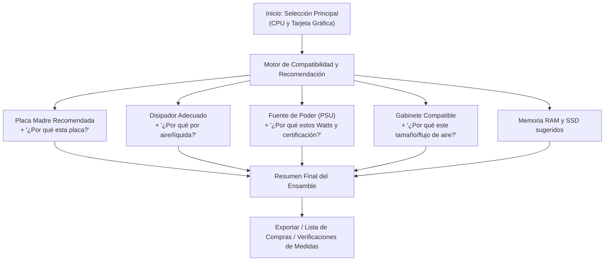
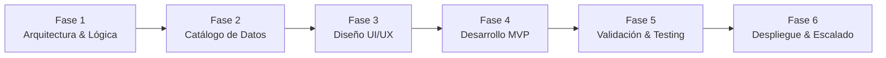

# 🛠️ Plan de Trabajo: Sistema Web Asistido de Armado de PC para Principiantes

Este documento establece la hoja de ruta y planificación estratégica para el desarrollo de una aplicación web enfocada en democratizar el ensamblaje de computadoras, guiando al usuario sin tecnicismos complejos a partir de la elección de los componentes centrales (**Procesador y Tarjeta Gráfica**) y recomendando el resto con explicaciones didácticas.

---

## 🎯 1. Visión y Propuesta de Valor

* **Problema actual:** Herramientas como PCPartPicker son excelentes para usuarios avanzados, pero abruman al principiante con cientos de opciones, filtros técnicos (VRMs, PCIe lanes, TDP, form factors) y poca explicación de *por qué* elegir una pieza sobre otra.
* **Nuestra solución:** Un flujo **tipo asistente (Wizard)** donde el usuario elige el "motor" de su equipo (CPU + GPU) y el sistema sugiere automáticamente una configuración equilibrada (Motherboard, Cooler, RAM, Fuente, Gabinete, Almacenamiento), justificando cada elección en lenguaje amigable y sin cuellos de botella (*bottlenecks*).

---

## 🗺️ 2. Flujo Conceptual del Usuario

---

## 📋 3. Fases del Plan de Trabajo

---

### 🔹 Fase 1: Definición de Arquitectura, Alcance y Reglas de Negocio
**Objetivo:** Establecer las bases técnicas y algorítmicas antes de escribir código.

* **1.1. Definición del Stack Tecnológico:**
  * **Frontend:** React / Next.js (o Vue / Nuxt) con TypeScript y Tailwind CSS para una interfaz ágil, reactiva y responsive.
  * **Backend / Lógica:** 
    * *Opción Ágil (MVP):* Lógica de compatibilidad en el frontend o micro-API con Node.js / Python (FastAPI).
    * *Persistencia:* Base de datos ligera (SQLite / PostgreSQL o JSON estructurado para el catálogo inicial).
* **1.2. Mapeo de Reglas de Compatibilidad:**
  * Socket CPU $\leftrightarrow$ Socket Placa Madre (ej. AM5, LGA1700).
  * TDP de CPU $\leftrightarrow$ Capacidad térmica requerida del disipador.
  * Consumo estimado (Watts CPU + Watts GPU + margen de seguridad del 20-30%) $\leftrightarrow$ Potencia y conectores de la Fuente.
  * Factor de forma de Placa (ATX, Micro-ATX, Mini-ITX) $\leftrightarrow$ Soporte del Gabinete.
  * Dimensiones físicas: Largo de GPU $\le$ Espacio del gabinete; Altura del cooler $\le$ Altura máxima de disipador del gabinete.
* **1.3. Matriz de "El Porqué" (Plantillas didácticas):**
  * Diseñar la estructura de explicaciones (ej. *"Te recomendamos una fuente de 750W porque tu procesador y gráfica consumen hasta 420W juntos; con 750W aseguras picos transitorios y eficiencia en el rango óptimo del 50-60%"*).

---

### 🔹 Fase 2: Estructuración y Modelado del Catálogo de Componentes
**Objetivo:** Tener un conjunto de datos consistente y curado para alimentar las recomendaciones.

* **2.1. Modelado de Datos (Esquema de Componentes):**
  * `CPUs`: Modelo, Socket, TDP, Frecuencia, Generación, Gráficos integrados (sí/no).
  * `GPUs`: Modelo, VRAM, Longitud (mm), Ranuras (slots), Watts TDP, Conectores PCIe requeridos.
  * `Motherboards`: Chipset, Socket, Factor de forma (ATX/mATX/ITX), Slots RAM, Soporte M.2, WiFi integrado.
  * `Coolers`: Tipo (Aire / AIO líquida), Altura (mm) o Tamaño del radiador (240/360mm), TDP soportado.
  * `PSUs`: Potencia (W), Certificación (80+ Bronze/Gold), Modularidad, Formato (ATX/SFX).
  * `Cases (Gabinetes)`: Factor de forma, Largo máx. GPU, Alto máx. cooler, Ventiladores incluidos.
  * `RAM / Almacenamiento`: DDR4 vs DDR5, capacidad estándar, Gen PCIe SSD.
* **2.2. Curación del Catálogo Inicial (MVP Curado):**
  * En lugar de miles de piezas desactualizadas, seleccionar los componentes más populares y vigentes del mercado actual (Intel 12ª-14ª gen, AMD Ryzen 5000/7000/9000, NVIDIA RTX serie 30/40 y AMD RX serie 6000/7000).

---

### 🔹 Fase 3: Diseño de Experiencia de Usuario (UI/UX)
**Objetivo:** Diseñar una interfaz visualmente limpia, libre de fricción y con foco pedagógico.

* **3.1. Pantalla de Selección Principal:**
  * Selector intuitivo de CPU y GPU con tarjetas visuales, nivel de gama (Entrada / Media / Alta / Entusiasta) y filtros sencillos.
* **3.2. Sección de Recomendaciones Asistidas:**
  * Tarjetas de componentes recomendados con una pestaña o acordeón destacado: **"¿Por qué te recomendamos esto?"**.
  * Indicador de "Nivel de equilibrio" o balance (para evitar que alguien ponga un i9 con una GTX 1650 o viceversa).
  * Posibilidad de cambiar un componente recomendado, mostrando solo las opciones que sean estrictamente compatibles.
* **3.3. Barra de Estado / Resumen Lateral:**
  * Barra con el consumo estimado de watts.
  * Lista de verificación de compatibilidad en tiempo real (todos los checks en verde).
  * Estimación de costo aproximado (opcional en fase inicial o configurable por rangos de precio).

---

### 🔹 Fase 4: Desarrollo del Core / MVP
**Objetivo:** Construir la aplicación funcional interactiva.

* **4.1. Sprint 1: Motor de Compatibilidad y Recomendación (Core Logic):**
  * Funciones de cálculo de compatibilidad matemática y física.
  * Algoritmo de sugerencia basada en tier/gama de CPU + GPU.
* **4.2. Sprint 2: Frontend & Wizard Interactivo:**
  * Componentes de selección y estado reactivo (al cambiar CPU o GPU, se recalculan y actualizan las sugerencias dinámicamente).
  * Visualización de las explicaciones contextuales.
* **4.3. Sprint 3: Detalle y Personalización:**
  * Modal para alternar piezas (ej. *"Prefiero refrigeración líquida por estética"* $\rightarrow$ el sistema sugiere una AIO compatible).
  * Alertas pedagógicas de incompatibilidad si el usuario fuerza una combinación incompatible.

---

### 🔹 Fase 5: Pruebas, Calibración y Casos de Uso Reales
**Objetivo:** Garantizar que ninguna recomendación sea incoherente o errónea.

* **5.1. Batería de Casos de Prueba Típicos:**
  * *Caso Económico / Entrada:* AMD Ryzen 5 5600 + Radeon RX 6600 (Placa B550 económica, cooler de stock o aire básico, 550W Bronze).
  * *Caso Gama Media Popular:* Intel Core i5-13400F o Ryzen 5 7600 + RTX 4060 / 4060 Ti (Placa B650/B760, disipador torre simple, 650W Gold).
  * *Caso Gama Alta Gaming:* AMD Ryzen 7 7800X3D + RTX 4080 Super (Placa B650 con buenos VRM, líquida 240/360mm o doble torre de aire, 850W ATX 3.0).
* **5.2. Evaluación de Textos Explicativos:**
  * Verificar que el lenguaje sea claro para personas sin conocimientos técnicos, evitando jerga no explicada.

---

### 🔹 Fase 6: Despliegue y Funcionalidades Futuras
**Objetivo:** Publicar la primera versión funcional y planear la evolución.

* **6.1. Despliegue del MVP:**
  * Alojamiento frontend (ej. Vercel, Netlify o similar).
* **6.2. Ideas para una Fase 2 (Evolución):**
  * Enlaces de afiliados o integración de precios locales (Amazon, tiendas locales según país).
  * Modo *"Armado guiado por presupuesto total"* (ej. "Tengo \$800 dólares, ármame lo mejor posible").
  * Exportar ensamble a PDF o enlace compartible para consultar con amigos o técnicos.

---

## 📌 4. Próximas Decisiones Clave para Iniciar

Antes de comenzar a programar cuando tú lo decidas, te convendrá definir:

1. **Stack preferido:** ¿Prefieres trabajarlo con **Next.js (React)** con Tailwind, o alguna otra tecnología con la que te sientas más cómodo?
2. **Alcance del catálogo inicial:** ¿Nos concentramos inicialmente en plataformas actuales (AM4, AM5, LGA1700) para mantener el catálogo ágil y fácil de mantener?
3. **Moneda / Precios:** ¿Deseas que el MVP muestre precios estimados (en USD u otra moneda local) o que por ahora se enfoque puramente en la **compatibilidad y las recomendaciones técnicas**?
